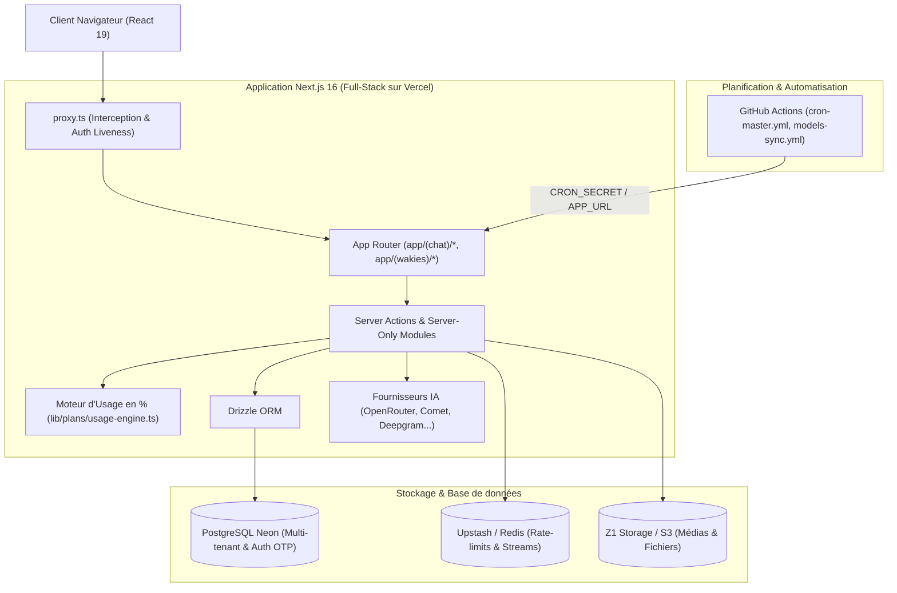

# Architecture globale de mAI Web — Refonte & Migration

mAI Web est conçu autour d'une architecture full-stack Next.js unifiée, directement connectée à PostgreSQL Neon, aux fournisseurs IA externes et orchestrée via GitHub Actions.

---

## 1. Rôle de l'Application Next.js 16 (Full-Stack)

L'application Next.js gère :
- **Le rendu de l'interface utilisateur** (React 19, streaming React Server Components).
- **L'authentification et sessions sécurisées sur Neon** : Codes OTP de vérification par email (`verification_codes`), révocation de jetons (`token_blacklist`), session utilisateur vérifiée directement en base de données.
- **La persistance des données utilisateur** : Conversations, messages, artefacts, configurations d'agents, espaces et pages Wakies, préférences via PostgreSQL Neon et Drizzle ORM.
- **Le moteur d'usage en pourcentage** (`lib/plans/usage-engine.ts`) : Calcul normalisé par forfait (Free: 100, Plus: 200, Pro: 400, Max: 1 000 unités), réinitialisé le lundi à 00:00 UTC, remplaçant l'affichage brut des tokens par message.
- **L'intégration directe des modèles IA** : Les requêtes s'adressent directement aux fournisseurs IA (OpenRouter pour LLM et GPT-6, Comet API pour les images). Les alias souverains mAI (mAI-2.5 Opal, Apex, Omni) sont résolus vers leurs backends respectifs (`openai/gpt-6.1-sol`, `openai/gpt-6.1-terra`, `openai/gpt-6-luna`) avec injection du prompt d'identité souverain.

---

## 2. Décommissionnement de Val Town & Planification GitHub Actions

- **Extinction programmée de Val Town** : Aucune dépendance critique ne repose désormais sur le runtime SQLite ou les vals de Val Town.
- **GitHub Actions comme ordonnanceur unique** :
  - `cron-master.yml` : Orchestrateur groupé haute performance déclenchant les ticks en parallèle (`scripts/cron/run-tick.mjs all`) toutes les 10 minutes avec protection contre l'épuisement du quota de minutes GitHub.
  - Workflows individuels (`cron-agent.yml`, `cron-planning.yml`, `cron-wakies.yml`, `cron-vibe.yml`, `cron-notifications.yml`, `cron-quizzly.yml`) déclenchables manuellement via `workflow_dispatch`.
  - `models-sync.yml` : Synchronisation biquotidienne (toutes les 12h) du catalogue de modèles IA.

---

## 3. Communication sécurisée et isolation

- **Validation des URLs amont (`safe-fetch.ts`)** : Toute requête sortante vers un domaine externe valide l'adresse IP de destination pour bloquer les attaques SSRF (Server-Side Request Forgery) sur les adresses privées (`127.0.0.1`, `169.254.169.254`, `10.0.0.0/8`...).
- **Secrets MCP et intégrations isolés** : Les clés et configurations des serveurs MCP sont chiffrées à l'aide d'AES-256-GCM (`MCP_ENCRYPTION_KEY`).
